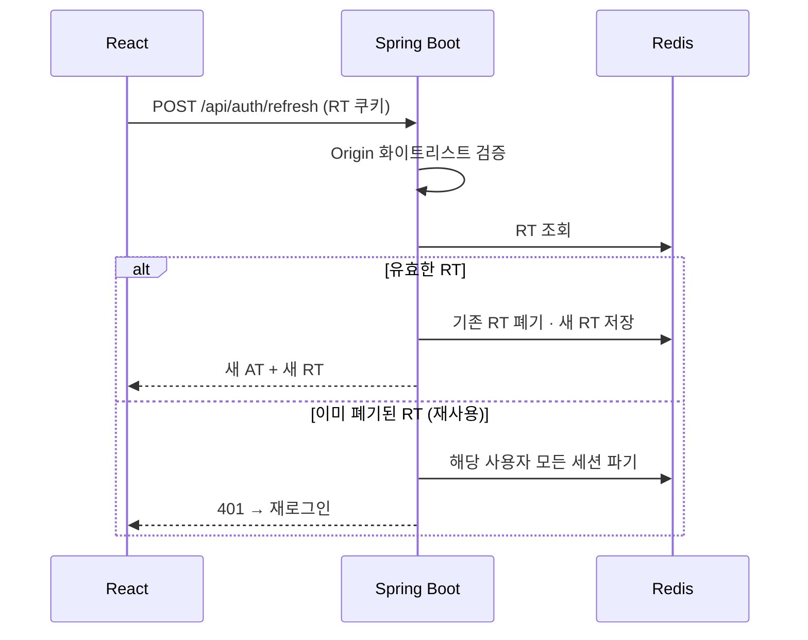
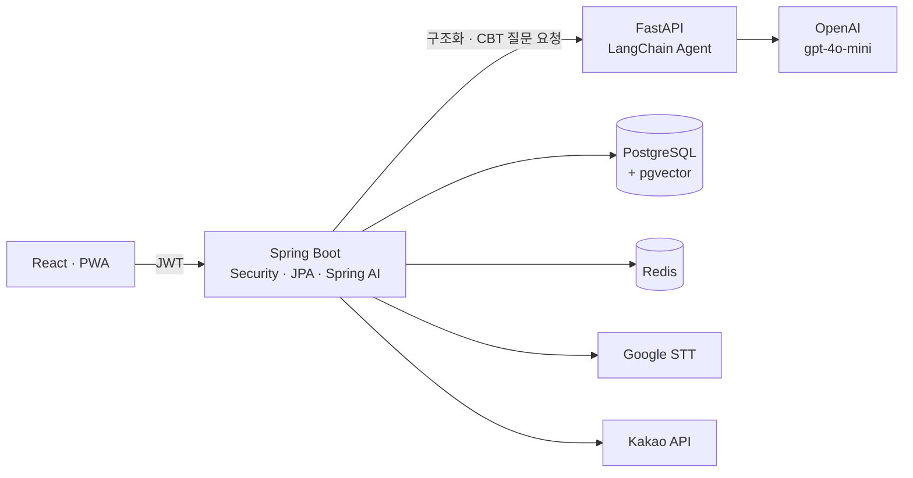
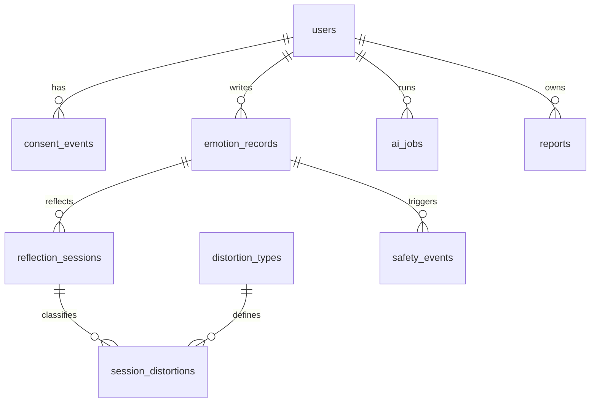
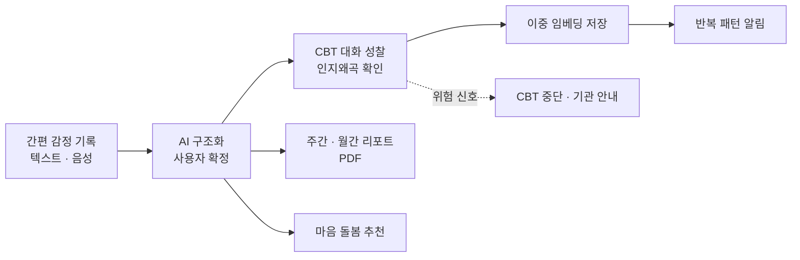
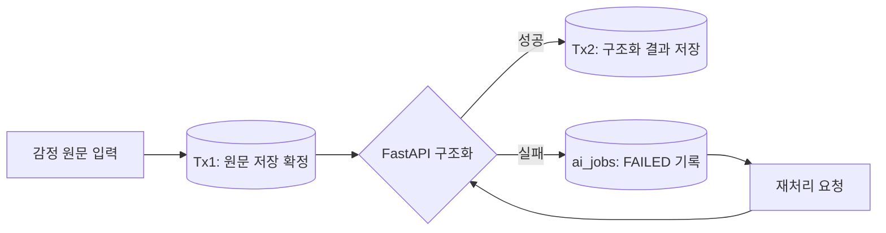

# 🟣 Mindot — 감정의 점을 잇고, '나'를 알아가는 감정 기록 플랫폼

> 한 줄 감정 기록을 AI가 **상황·감정·생각**으로 구조화하고, CBT(인지행동치료) 질문 대화로 **인지왜곡**을 돌아보게 하는 자기이해 서비스

| 항목 | 내용 |
|---|---|
| 기간 | 2026.08.04 ~ 2026.09.29 (약 8주) |
| 소속 | 휴먼AI교육센터 · AI·빅데이터 웹솔루션 개발자 양성 과정 최종 프로젝트 |
| 인원 | 3명 (AI/Architecture 1 · Backend 1 · Frontend 1) |
| 내 역할 | **Backend · Security** (인증·DB·API) |
| 배포 | https://mindot.app |
| 원본 레포 | [JephyrWing/project_mindot](https://github.com/JephyrWing/project_mindot) |

> 팀 프로젝트 원본을 포크한 레포입니다. 전체 구조를 함께 설명하되, **내 담당 항목은 ✅로 표시**했습니다.

## 목차

| # | 구분 | 내용 |
|---|---|---|
| 01 | 프로젝트 개요 | 기획 배경·문제 정의 · 기존 방식과 차별점 · 서비스 컨셉 · 목표와 기대효과 |
| 02 | 시스템 개요 | 요구사항 명세 · 기술 스택 · 인증 보안 · 아키텍처 · API 설계 · DB 구조 · AI 결과 검증 |
| 03 | 서비스 구현 | 서비스 구조 · 핵심 기능 · 시연 흐름 |
| 04 | 테스트 | 테스트 결과 · 비기능 요구사항 검증 |
| 05 | 발전방향 및 회고 | 개발 성과 · 트러블슈팅 · 개선 방향 · 배운 점 |

---

# 01. 프로젝트 개요

## 1.1 기획 배경과 문제 정의

> 감정을 키우는 것은 사건 자체보다, **확인되지 않은 해석을 사실로 굳히는 것**일 수 있습니다.

| 단계 | 예시 |
|---|---|
| 객관적 사실 (Fact) | 보고 중 팀장님의 굳은 표정 |
| 자동적 사고 (Automatic Thought) | "내가 실수해서 화난 게 분명해" |
| 파생되는 고통 (Reaction) | 극심한 불안, 하루 종일 이어지는 자기검열 |

CBT(인지행동치료)는 이런 자동적 사고를 소크라테스식 질문("근거가 있는가?", "반대 증거는?", "다른 가능성은?")으로 스스로 돌아보게 하는 방법입니다. 하지만 기존 사고 기록지는 꾸준히 쓰기 어렵습니다.

| 문제 | 설명 |
|---|---|
| Q1 정서 소진 | 감정이 격한 순간에는 복잡한 서식을 채우기 어렵다 |
| Q2 맥락 휘발 | 나중에 쓰려고 미루면 당시 상황과 생각이 흐려진다 |
| Q3 완성 압박 | 빈칸을 다 채워야 한다는 부담이 기록 자체를 끊는다 |
| Q4 패턴 파악 어려움 | 기록이 쌓여도 내 감정·생각의 반복 패턴을 스스로 찾기 어렵다 |

**타깃 사용자**: 감정을 기록하고 싶지만 긴 일기나 복잡한 입력을 지속하기 어려운 사람

## 1.2 기존 방식과 Mindot의 차별점

| 구분 | 전통적 사고 기록지 | Mindot |
|---|---|---|
| 기록 시작 | 상황·감정·생각을 서식에 직접 작성 | **한 줄 텍스트·음성(STT)** 만으로 시작 |
| 기록 완성 | 한 번에 모두 채워야 함 | 원문 먼저 저장, **나중에 보완** (비동기 완성) |
| 구조화 | 사용자가 직접 분류 | **AI가 자동 추출**, 사용자는 확인·수정만 |
| 성찰 | 혼자 질문에 답함 | **AI CBT 대화**로 질문을 이어가며 성찰 |
| 회고 | 직접 다시 읽어야 함 | **반복 패턴 알림 · 주간/월간 리포트 · PDF** |

## 1.3 서비스 컨셉과 운영 원칙

| 원칙 | 내용 |
|---|---|
| 01 시작 비용 최소화 | 완벽한 기록보다 '시작'을 설계 — 빈칸이 있어도 실패 처리하지 않음 |
| 02 AI는 제안, 사용자가 확정 | AI의 구조화·인지왜곡 라벨을 사실이나 진단으로 확정하지 않고 사용자가 확인·추가·거절 |
| 03 확인된 데이터만 근거로 | **CONFIRMED 데이터만** 통계·pgvector·반복 패턴 근거로 사용 |
| 04 안전 우선 | 위험 신호 감지 시 CBT를 즉시 중단하고 전문기관 안내 |
| 05 서비스 성격 | 자기기록·자기이해 보조 도구 — 의료·진단·치료·상담을 대체하지 않음 |

## 1.4 목표와 기대효과

| 목표 | 기대효과 |
|---|---|
| 기록 부담 완화 | 한 번의 동작으로 기록을 시작해 기록 빈도와 지속성 향상 |
| 생각 전후 변화의 데이터화 | CBT 질문 전후의 사고·인지왜곡·감정 강도 변화를 비교 |
| 근거가 추적되는 자기이해 | 시간대·상황·관계별 감정 분포와 반복 패턴을 근거 기록과 함께 확인 |
| 상담 연계 | 리포트를 PDF로 내보내 상담·진료 시 참고 자료로 활용 |

| 핵심 지표 (초안) | MVP 목표 |
|---|---|
| 원문 저장 성공률 | 99% 이상 |
| 확인 전 AI 해석이 패턴 근거로 사용된 건수 | 0건 |
| 구조화·인지왜곡 라벨 승인·수정률, 7일 내 3회 이상 기록 비율 | 베타에서 측정 후 확정 |

---

# 02. 시스템 개요

## 2.1 요구사항 명세

### 기능 요구사항 (FR)

| ID | 영역 | 완료 기준 | 상태 | 담당 |
|---|---|---|---|---|
| FR-01 | 회원 인증 | 회원가입·로그인·토큰 재발급(RTR)·로그아웃 | 구현 | ✅ |
| FR-02 | 소셜 로그인 | 카카오·구글 OAuth, 소셜 신규 회원 동의 절차 | 구현 | ✅ |
| FR-03 | 동의 관리 | 서비스·AI 분석 동의, 철회·재동의, 동의 이력 저장 | 구현 | ✅ |
| FR-04 | 회원 관리 | 내 정보, 회원 탈퇴 시 세션 무효화 | 구현 | ✅ |
| FR-05 | 간편 감정 기록 | 한 줄 원문 저장, 음성 입력(STT) | 구현 | ✅ |
| FR-06 | AI 구조화 | 상황·감정·생각 추출 → 사용자 확정·거절·재분석, 누락 정보 보완 질문 | 구현 | ✅ (연동) |
| FR-07 | 감정 기록 관리 | 목록·상세·검색 필터·페이징·발생 시각 수정·삭제 | 구현 | ✅ |
| FR-08 | CBT 성찰 | 세션 시작·답변·다음 질문·중단·이어하기·최종 확정 | 구현 | ✅ (Spring) |
| FR-09 | 인지왜곡 분류 | 12가지 유형 제안·확인, 성찰 전후 비교 저장 | 구현 | ✅ |
| FR-10 | 의미 기반 검색 | pgvector 유사도 검색 | 구현 | ✅ |
| FR-11 | 반복 패턴 알림 | 유사 CBT 기록 기반 패턴 설명·알림·피드백 | 구현 | ✅ |
| FR-12 | 리포트 | 주간·월간 감정 리포트, 근거 기록 목록 | 구현 | ✅ |
| FR-13 | PDF 내보내기 | 주간·월간 리포트, CBT 결과 상담용 PDF | 구현 | ✅ |
| FR-14 | 감정 인사이트 | 시간대·상황·관계별 감정 분포 | 구현 | ✅ |
| FR-15 | 마음 돌봄 추천 | 감정 기반 명상 영상 추천·피드백 | 구현 | ✅ |
| FR-16 | 관련 기관 찾기 | 지역·유형별 마음건강 지원기관 검색 | 구현 | ✅ (백·프론트) |
| FR-17 | 안전 신호 | 위험 신호 감지 시 이벤트 저장·CBT 중단·안내 | 구현 | ✅ |
| FR-18 | 관리자 | 회원·안전 신호 조회, 페이징 | 구현 | ✅ |
| FR-19 | 알림 | 반복 패턴 알림, 읽음 처리, 알림 설정 | 구현 | ✅ |
| FR-20 | CBT 질문 생성 AI | LangChain Agent 기반 질문 생성·튜닝 | 구현 | 팀 (AI 담당) |
| FR-21 | 화면·PWA | 반응형 UI, PWA 설치 | 구현 | 팀 (Front 담당) |

### 비기능 요구사항 (NFR)

| ID | 영역 | 검증 기준 | 구현 방식 | 담당 |
|---|---|---|---|---|
| NFR-01 | 인증 | 짧은 Access Token, 안전한 Refresh Token 보관 | AT 10분·SessionStorage / RT HttpOnly·SameSite·Secure 쿠키 | ✅ |
| NFR-02 | 토큰 탈취 대응 | 재사용된 RT로 재발급 불가 | RTR + 재사용 감지 시 해당 사용자 Redis 세션 전체 파기 | ✅ |
| NFR-03 | 권한·소유권 | 타인 데이터 접근(IDOR) 차단 | 요청 본문의 userId를 신뢰하지 않고 `@AuthenticationPrincipal`로 주입 | ✅ |
| NFR-04 | 위조 요청 차단 | 민감 인증 API의 외부 요청 거부 | Refresh·Logout에 Origin 화이트리스트 검증 | ✅ |
| NFR-05 | 계정 상태 | 정지·탈퇴 계정은 토큰이 남아도 차단 | 요청마다 DB에서 계정 상태·역할 재확인 | ✅ |
| NFR-06 | 데이터 보존 | AI 실패 시에도 원문 유실 없음 | 원문 저장과 AI 호출 트랜잭션 분리 | ✅ |
| NFR-07 | 장애 복구 | 실패 작업 재시도 가능 | `ai_jobs` 상태·이력·멱등 키, 재처리 API | ✅ |
| NFR-08 | 중복 방지 | 같은 요청의 중복 저장 방지 | 녹음·변환·저장 중 요청 잠금, 같은 저장 요청 키로 재시도 | 팀 |
| NFR-09 | 입력 검증 | 빈 내용·과도한 길이 차단 | 빈 값·1,000자 초과 검사 | 팀 |
| NFR-10 | 데이터 정합성 | 기록 변경 시 리포트 최신화 | 해당 기간 리포트 캐시 무효화, 동시 요청 처리 | ✅ |
| NFR-11 | 개인정보 보호 | 동의 기반 AI 분석, 민감 원문 접근 제한 | AI 분석 동의·철회, CRISIS 원문은 관리자 제한 조회 | ✅ |
| NFR-12 | 성능 | 조회 패턴에 맞는 응답 | DB 인덱스 보강, 목록 페이징 | ✅ |
| NFR-13 | 사용성 | 모바일 사용 | 반응형 UI, PWA | 팀 |
| NFR-14 | 유지보수·배포 | 회귀 테스트, 자동 배포 | JUnit·Pytest·Playwright, GitHub Actions CI/CD | 팀 |

## 2.2 기술 스택

| 영역 | 기술 | 역할 |
|---|---|---|
| Backend | Java · Spring Boot · Spring Web · Lombok | REST API, 업무 규칙, 트랜잭션 |
| 데이터 접근 | Spring Data JPA (Query Method · JPQL · Native Query) | 조회·저장, pgvector 유사도 검색 |
| 인증·보안 | Spring Security · JWT · Refresh Token Rotation | 인증·권한, 세션 관리 |
| 임베딩 | Spring AI · OpenAI text-embedding-3-small | 1536차원 임베딩 생성 |
| AI 서비스 | Python · FastAPI · Pydantic · LangChain Agent · gpt-4o-mini | 자연어 구조화, CBT 질문 추론 |
| DB | PostgreSQL · pgvector · Redis | 정형 데이터 + 벡터, Refresh Token 저장 |
| Frontend | React · Axios · PWA | 화면, 모바일 설치 |
| 외부 API | Google Cloud Speech-to-Text · Kakao Login · Kakao Local · Google OAuth | 음성 변환, 소셜 로그인, 기관 검색 |
| 문서 | Apache PDFBox | 리포트 PDF 생성 |
| 테스트 | JUnit (Back) · Pytest (FastAPI) · Playwright (Front) | 회귀 테스트 |
| 운영 | Docker · Docker Compose · AWS EC2 · GitHub Actions | 컨테이너 실행, CI/CD |

## 2.3 인증 보안 ✅

### 토큰 구조

| 토큰 | 보관 위치 | 수명 | 역할 |
|---|---|---|---|
| Access Token | SessionStorage | 10분 | API 요청 인증 |
| Refresh Token | HttpOnly · SameSite · Secure 쿠키 | — | Access Token 재발급 |
| RT 저장소 | Redis | — | RTR 단일 사용 검증, 세션 블랙리스트 |

### Refresh Token Rotation 흐름



### 요청 인증과 사용자 식별

| 순서 | 처리 |
|---|---|
| 1 | `Authorization: Bearer {JWT}` 헤더에서 토큰 추출 |
| 2 | 서명·형식·만료 검증 |
| 3 | subject에서 `Long userId` 추출 |
| 4 | DB에서 계정 상태(`ACTIVE`)·역할 재확인 |
| 5 | `UsernamePasswordAuthenticationToken`의 principal에 `userId` 저장 |
| 6 | Controller가 `@AuthenticationPrincipal Long userId`로 바로 사용 |

```java
new UsernamePasswordAuthenticationToken(user.getId(), null, authorities);
```

## 2.4 시스템 아키텍처



| 계층 | 역할 |
|---|---|
| React | 화면, 입력, PWA |
| **Spring Boot** | 모든 요청의 단일 관문 — 보안 검증, DB CRUD, 임베딩 저장·유사도 검색, FastAPI 중계 및 **각 응답 저장** |
| FastAPI | AI 전담 — 자연어 구조화, CBT 질문 생성 (벡터 저장용 임베딩은 Spring이 담당) |
| PostgreSQL + pgvector | 정형 RDB + 1536차원 벡터 |
| Redis | Refresh Token Store |

> React는 FastAPI를 직접 호출하지 않고 **반드시 Spring을 거칩니다.** 보안 검증을 한 곳에서 통제하고, Spring이 각 응답을 저장하므로 중간에 오류가 나거나 중단해도 복구해 이어서 진행할 수 있습니다.

## 2.5 API 설계

### 공통 규칙

| 규칙 | 내용 |
|---|---|
| 기본 경로 | `/api` · JSON 요청·응답 |
| 인증 | `Authorization: Bearer {accessToken}` |
| 본인 식별 | JWT의 회원 ID 사용, 요청의 userId를 신뢰하지 않음 |
| 공개 API | signup · login · refresh · logout · OAuth |

### 대표 API ✅

| 도메인 | Base Path | 대표 엔드포인트 |
|---|---|---|
| 인증 | `/api/auth` | `POST signup` · `login` · `refresh` · `logout` · `oauth/kakao` · `oauth/google` · `oauth/signup` |
| 동의 | `/api/consents` | `POST {type}/grant` · `{type}/revoke` |
| 내 정보 | `/api/users/me` | 조회 · 탈퇴 |
| 감정 기록 | `/api/records` | `POST quick` · `{id}/confirm` · `{id}/reject` · `{id}/reanalyze` · `{id}/retry-embedding` · `GET semantic-search` · `{id}/questions/missing` |
| CBT 성찰 | `/api/reflections` | `POST open` · `{sid}/turn` · `{sid}/confirm` · `{sid}/cancel` · `{sid}/retry` · `GET completed` · `open/paged` |
| 반복 패턴 | `/api/patterns` | `POST patterns/generate` · `{id}/feedback` · `{recordId}/pattern-explanation` |
| 리포트 | `/api/reports` | `GET·POST weekly` · `monthly` |
| 인사이트 | `/api/insights` | `GET emotions` |
| 알림 | `/api/notifications` | `GET recent` · `unread-count` · `PATCH {id}/read` · 알림 설정 |
| 마음 돌봄 | `/api/daily-care` | `GET recommendation` · `POST recommendations/{id}/feedback` |
| 기관 검색 | `/api/centers` | 지역·유형별 검색 |
| 음성 변환 | `/api/stt` | 음성 → 텍스트 |
| 안전 신호 | `/api/safety-events` | 조회 · `{id}/notice-shown` |
| 관리자 | `/api/admin/users` · `/api/admin/safety-events` | 회원·안전 신호 목록 |

## 2.6 DB 구조 ✅

| 테이블 | 주요 컬럼 | 용도 |
|---|---|---|
| `users` | email · password_hash · status · user_role · deleted_at | 회원, 계정 상태 |
| `consent_events` | consent_type · consent_version · action | 동의·철회 이력 |
| `emotion_records` | raw_text · situation · automatic_thought · primary_emotion · intensity · time_bucket | 감정 원문·구조화 결과 |
| `reflection_sessions` | status · current_step · question_answers(jsonb) · before/after_belief_strength · helpfulness_score | CBT 세션, 대화 누적 |
| `session_distortions` | distortion_type · phase · review_status · context_embedding · thought_aware_embedding (vector 1536) | 인지왜곡 분류, 이중 임베딩 |
| `distortion_types` | code · name_ko · name_en · description | 12가지 인지왜곡 기준 데이터 |
| `ai_jobs` | entity_type · operation · idempotency_key · status · attempt_no · model_name | AI 작업 이력·재처리 |
| `reports` | report_type · period_start · period_end · content(jsonb) · source_snapshot_at | 주간·월간 리포트 스냅샷 |
| `safety_events` | risk_level · reason_code · action_code · notice_shown_at | 위험 신호 이벤트 |

> FK cascade 적용, 조회 패턴에 맞춘 인덱스 보강



## 2.7 AI 결과 검증과 이중 임베딩

| 단계 | 처리 |
|---|---|
| 01 AI는 제안만 | 구조화 결과·인지왜곡 라벨은 `PROPOSED` 상태로 저장 |
| 02 사용자 확정 | 사용자가 확인·수정·거절해야 `CONFIRMED` |
| 03 확정 데이터만 활용 | 통계·패턴·임베딩은 확정된 데이터만 사용 |
| 04 이중 임베딩 ✅ | CBT 완료 시 두 종류의 벡터 저장 |
| 05 유사 사례 검색 ✅ | 새 기록의 '처음 든 생각' 유무에 따라 다른 벡터로 검색 |

| 임베딩 | 포함 정보 | 쓰임 |
|---|---|---|
| `context_embedding` | 상황 범주 · 상황 · 감정 · 시간 범주 | 생각을 적지 않은 약식 기록에서도 유사 사례 검색 |
| `thought_aware_embedding` | 위 항목 + 처음 든 생각 | 생각까지 적은 기록의 정밀 검색 |

| 반복 패턴 알림 조건 | 값 |
|---|---|
| 누적 완료 CBT 세션 | 10회 이상 |
| 유사도 기준 | Cosine 0.7 초과 |
| 조언 생성 | 유사 사례 목록을 FastAPI로 전달해 자연어 조언 생성 |

---

# 03. 서비스 구현

## 3.1 서비스 구조



## 3.2 핵심 기능

| # | 기능 | 설명 | 담당 |
|---|---|---|---|
| 01 | 간편 감정 기록 | 한 줄 입력·음성 → 상황·감정·생각 자동 추출 → 사용자 확정 | ✅ API·연동 |
| 02 | AI CBT 대화 성찰 | 소크라테스식 질문으로 인지왜곡 확인, 대화 전체를 JSON으로 매 턴 누적 저장 | ✅ Spring 세션 / AI 질문 생성은 팀 |
| 03 | 반복 패턴 알림 | 과거 유사한 상황·감정의 인지왜곡 패턴을 미리 안내 | ✅ |
| 04 | 주간·월간 리포트 & PDF | 요일·시간대·상황별 감정 분포, 상담용 PDF | ✅ |
| 05 | 감정 인사이트 | 시간대·상황·관계별 감정 분포 | ✅ |
| 06 | 마음 돌봄 추천 | 감정에 맞춘 명상 영상 추천 | ✅ |
| 07 | 관련 기관 찾기 | 지역·유형별 마음건강 지원기관 | ✅ |
| 08 | 안전 신호 대응 | 위험 신호 즉시 중단, 전문기관 안내 | ✅ |

### ① 간편 감정 기록

| 단계 | 내용 |
|---|---|
| 음성을 글로 | 녹음 종료 후 자동 변환(Google STT), 변환된 문장은 직접 수정 |
| 중복 저장 방지 | 녹음·변환·저장 중 요청 잠금 |
| 실패 후 재시도 | 입력 내용 유지, 같은 저장 요청 키로 재시도 |
| 원문 우선 저장 | 원문을 먼저 확정한 뒤 AI 구조화 요청 |

### ② CBT 성찰 세션

| 단계 | 내용 |
|---|---|
| 세션 시작 | 감정 기록을 바탕으로 첫 질문 생성 |
| 답변·다음 질문 | 답변 저장 후 FastAPI에 다음 질문 요청, 처리 중 입력 잠금 |
| 인지왜곡 제안 | 사용자가 생각을 재고하면 인지왜곡 유형 제안 |
| 결과 확정 | 제안별 검토 결과와 점수(belief strength·도움 점수) 입력 |
| 이어하기·종료 | 세션 ID로 복원, 완료·중단 사유 구분 |
| 완료 후 | 성찰 전후 비교 저장, 이중 임베딩 생성 |

### ③ 리포트

| 리포트 | 주요 통계 |
|---|---|
| 주간 | 요일·시간대 감정 분포, CBT 완료 건수·평균 도움 점수, 반복 감정 패턴, 근거 기록 목록 |
| 월간 | 상황별·날짜별 감정 분포, 월초/월말 비교, 월 전체 분포 |
| 인사이트 | 전체 기록 기반 시간대·상황·관계별 감정 분포 |

## 3.3 시연 흐름

| 순서 | 단계 | 내용 |
|---|---|---|
| 01 | 회원가입·로그인 | 일반·카카오·구글, 동의 절차 |
| 02 | 감정 기록 | 텍스트 또는 음성으로 한 줄 기록 |
| 03 | AI 구조화 확인 | 상황·감정·생각 확인 후 확정 |
| 04 | CBT 성찰 | 질문에 답하며 인지왜곡 확인 |
| 05 | 패턴·리포트 | 반복 패턴 알림, 주간·월간 리포트, PDF |
| 06 | 마음 돌봄·기관 찾기 | 명상 추천, 주변 기관 검색 |

---

# 04. 테스트

## 4.1 테스트 결과

| 구분 | 도구 | 전체 | P0 | 통과 | 실패 | 통과율 |
|---|---|---|---|---|---|---|
| **Back** ✅ | JUnit | 37 | 27 | 37 | 0 | 100% |
| FastAPI | Pytest | 17 | 15 | 17 | 0 | 100% |
| Front | Playwright | 33 | 15 | 33 | 0 | 100% |
| **합계** | | **87** | **57** | **87** | **0** | **100%** |

| 출시 판정 기준 | 기준 | 결과 |
|---|---|---|
| P0 실패 | 0건 | 충족 |
| 선택 오류 | 0건 | 충족 |
| 미실행 | 0건 | 충족 |

**백엔드 주요 통합 테스트** ✅

| 테스트 | 검증 내용 |
|---|---|
| EmotionQuickFlowTest | 간편 기록 → AI 구조화 → 확정 흐름 |
| ReflectionTurnFlowTest | CBT 세션 턴 진행·저장 |
| SemanticSearchApiTest | pgvector 의미 기반 검색 |
| EmotionRecordRejectApiTest | AI 제안 거절 |
| EmotionRecordMissingQuestionsApiTest | 누락 정보 보완 질문 |
| DailyCareRecommendationIntegrationTest | 마음 돌봄 추천·피드백 |

> CBT 질문 생성 AI의 품질은 별도 평가(총 768건 실행)로 검증했습니다. (AI 담당 팀원 작업)

## 4.2 비기능 요구사항 검증

| ID | 영역 | 근거 | 결과 |
|---|---|---|---|
| NFR-01~05 | 인증·보호 | 인증 흐름, 소유권 검증 테스트 | 검증됨 |
| NFR-06~07 | 데이터 보존·복구 | AI 실패·재처리 흐름 테스트 | 검증됨 |
| NFR-08~09 | 중복 방지·입력 검증 | 프론트 테스트 | 검증됨 |
| NFR-10 | 정합성 | 기록 수정·삭제 시 리포트 갱신 | 검증됨 |
| NFR-14 | 유지보수·배포 | 87개 항목 CI 실행 | 검증됨 |
| — | 부하·가용성 | 동시 사용자·TPS | 미실시 (향후 과제) |

---

# 05. 발전방향 및 회고

## 5.1 개발 성과 (내 담당) ✅

| 영역 | 성과 |
|---|---|
| 인증·보안 | JWT + RTR + 탈취 감지, 소셜 로그인, 동의 관리, Origin 검증, IDOR 차단 |
| 데이터 | 감정 기록·CBT·AI 작업·리포트·안전 신호 스키마 설계, 인덱스·FK cascade |
| AI 연동 안정화 | 트랜잭션 분리, AI 작업 이력·실패 재처리 |
| 검색·패턴 | pgvector 이중 임베딩, 의미 기반 검색, 반복 패턴 알림 |
| 리포트 | 주간·월간 집계, 캐시 무효화, PDF 내보내기 |
| 운영 | 안전 신호, 관리자 조회, 기관 검색, STT 연동, 통합 테스트 |

## 5.2 트러블슈팅

### ① AI 장애가 원문 유실로 번지는 문제

| 구분 | 내용 |
|---|---|
| 문제 | 원문 저장과 AI 구조화 호출이 하나의 트랜잭션 → FastAPI가 실패하면 **사용자가 쓴 원문까지 롤백** |
| 원인 | 외부 AI 호출을 DB 트랜잭션 안에 포함 |
| 해결 | 원문 저장을 **독립 트랜잭션으로 먼저 확정**, AI 호출·결과 저장은 별도 트랜잭션으로 분리 |
| 보완 | `ai_jobs`로 작업 상태·실패 이력 기록, 실패 건 **재처리 API** 제공 |
| 확장 | CBT 질문 생성, CBT 완료 후 임베딩 생성에도 같은 원칙 적용 |
| 결과 | AI가 실패해도 확정된 데이터는 보존, 사용자는 이어서 재시도 가능 |



### ② 사용자 식별 로직이 기능마다 반복되는 문제

| 구분 | 내용 |
|---|---|
| 배경 | 이전 프로젝트(LinkUs)에서 프론트를 맡았을 때, 요청마다 사용자 ID를 직접 관리·전달해야 했음 |
| 문제 | 기능이 늘수록 식별·검증 코드가 반복되고, 누락 시 타인 데이터 접근(IDOR) 위험 |
| 해결 | JWT 필터가 검증된 `Long userId`를 principal로 저장 → Controller에서 `@AuthenticationPrincipal Long userId`로 주입 |
| 결과 | 프론트는 JWT만 전송, 감정 기록·CBT·리포트 소유권 검증을 백엔드에서 일관되게 처리 |

### ③ 리포트 캐시 불일치와 불필요한 트랜잭션

| 구분 | 내용 |
|---|---|
| 문제 | 감정 기록을 수정·삭제해도 이미 생성된 주간 리포트에 이전 값이 남음 |
| 해결 | 변경된 기록이 속한 기간의 리포트 캐시 무효화, 근거 기록 시간 복구 |
| 함께 정리 | 불필요한 트랜잭션 제거, API 오류 응답 정리, 리포트 동시 요청 처리 |

## 5.3 개선 방향

| 구분 | 내용 |
|---|---|
| 성능 검증 | 동시 사용자·TPS 기준을 정하고 부하 테스트 실시 |
| 지표 측정 | 원문 저장 성공률, 라벨 승인·수정률, 기록 지속률 실측 |
| 관측성 | AI 작업 실패율·지연 시간 모니터링 |

## 5.4 배운 점

| 키워드 | 내용 |
|---|---|
| 실패 우선 설계 | 외부 시스템 연동에서는 "성공하는가"보다 "실패했을 때 무엇을 지킬 것인가"를 먼저 설계해야 한다 |
| 보안은 구조로 | 검증을 개발자 기억에 맡기지 않고, 인증 컨텍스트에서 사용자 ID를 받는 구조로 강제 |
| 양쪽 관점 | 프론트(LinkUs) → 백엔드(Mindot)를 모두 경험하며, 작업 전에 화면 요구사항·오류 응답·페이징 방식을 정리해 공유하는 습관 |
| 피드백 반영 | 발표 피드백을 반영해 기관 찾기, 마음 돌봄 추천 기능 추가 |
| 성장 | 중간 프로젝트는 프론트, 최종 프로젝트는 백엔드를 맡아 기능을 하나씩 구현하고 오류를 해결하며 한 단계 성장 |
